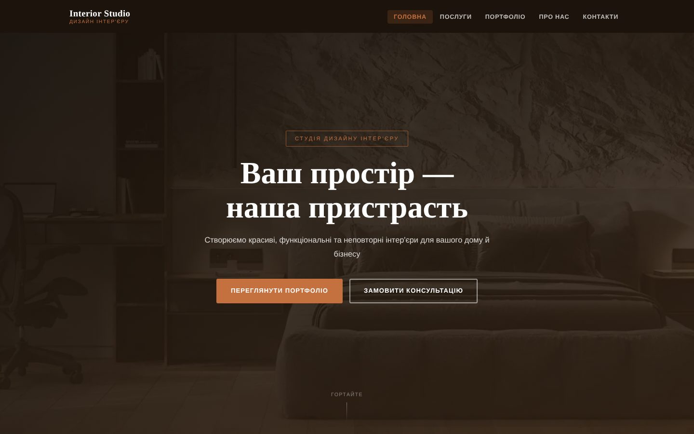

# Interior Studio

[](https://whiteinfra.github.io/interior-studio/)


A responsive three-page website for a fictional interior design studio, written in **vanilla HTML, CSS and JavaScript** with no frameworks, and hosted on **GitHub Pages**.

**Live:** https://whiteinfra.github.io/interior-studio/

<p align="center">
  
  
</p>

## Features

- Pages: home, services, contact
- Responsive layout with breakpoints at 1920, 1024, 768 and 480 px; burger menu on mobile
- Sticky header that changes on scroll, active link highlighting, smooth scrolling
- Portfolio filter by category
- Contact form with client-side validation: name, email format, phone (10+ digits), service type, message length, with inline error messages

## Structure

```
├── index.html       # home: hero, about, services, portfolio, reviews
├── services.html    # residential, commercial, supervision + pricing
├── contact.html     # contact form
├── css/
│   ├── reset.css
│   └── styles.css
├── js/
│   └── main.js      # navigation, filter, form validation
└── images/
```

## Run locally

No build step: clone and open `index.html` in a browser, or serve the folder:

```bash
python -m http.server 8000   # http://localhost:8000
```

> Coursework project for the Web Technologies course. Site content is in Ukrainian.
